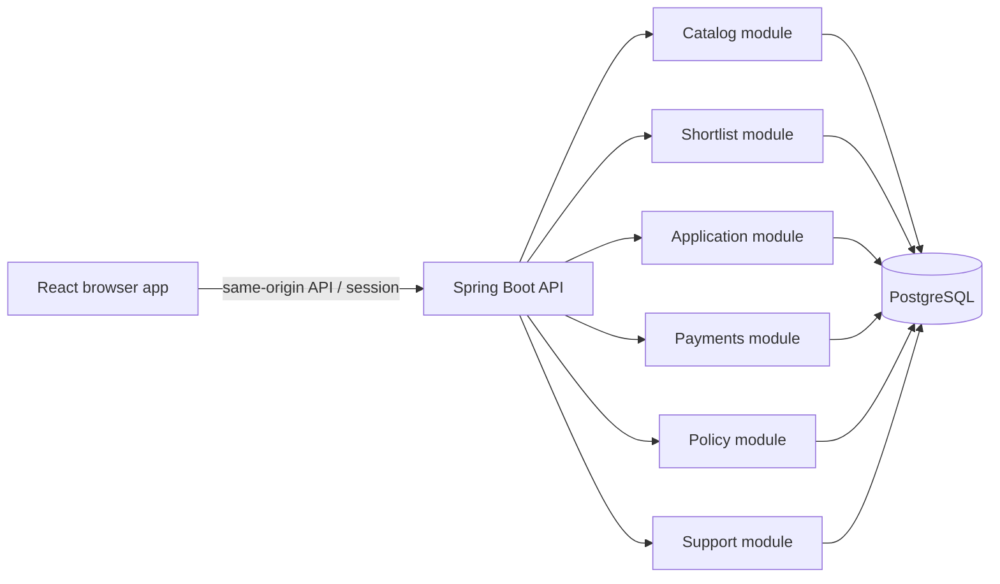
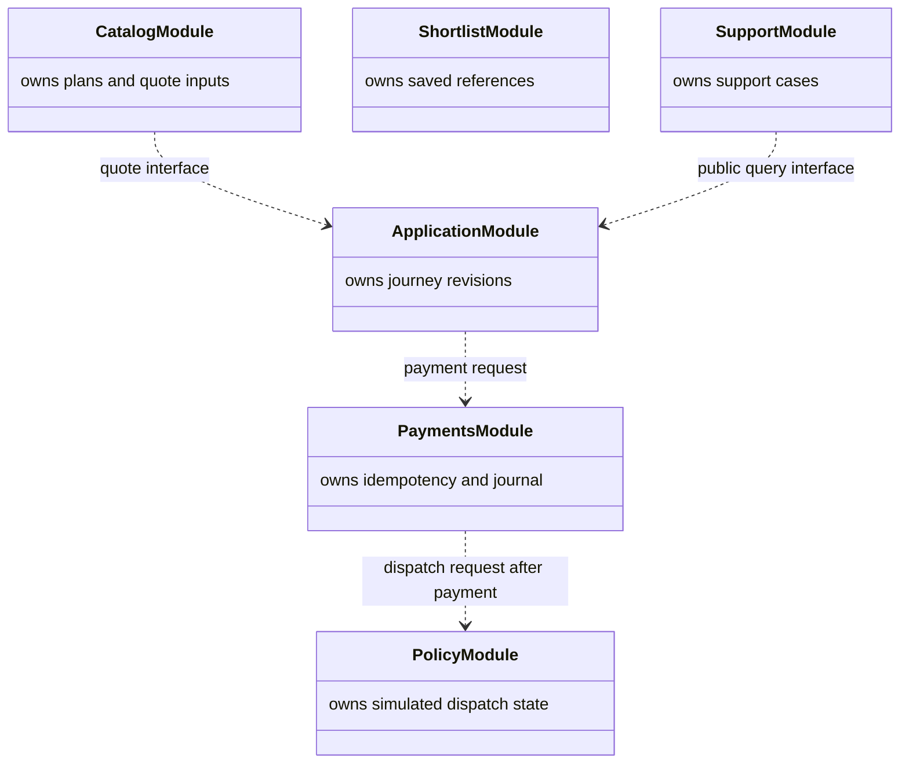

# CoverStory architecture guide

## Product boundary

CoverStory is a learning simulation of an insurance marketplace. No insurer, payment processor, refund rail, or policy administrator is connected. A successful simulated payment is not proof that a provider received an application or that cover is active. Keep consumer-facing states explicit: `payment_recorded`, `dispatch_pending`, `dispatch_confirmed`, `cancelled`, and `reconciliation_required` are distinct facts. An application stays pending until a simulated provider confirms dispatch.

## Runtime shape



Start as a modular monolith. Each module owns its tables, repositories, validation, and application services. Cross-module calls use a public application interface; there are no cross-module repository imports. The runnable API shell exposes an intentionally unauthenticated `401 /api/session` response and a `501 /api/catalog` response until real auth and learner catalog behavior are supplied. Add Kafka, Redis, or another database only after a measured need and a written trade-off. They are not prerequisites for local startup.

## Module ownership

| Module | Owns | Public collaboration surface |
| --- | --- | --- |
| Catalog | Synthetic insurer/product/plan catalog and versioned simulated quote inputs | Search and quote request interface |
| Shortlist | Owner-scoped saved product references and list ordering | Add, remove, and list operations |
| Application | Application journey and revisions; authoritative quote reference | Create, revise, and submit operations |
| Payments | Simulated payment intents, idempotency keys, and immutable journal | Begin, confirm, cancel, reconcile operations |
| Policy | Simulated dispatch and policy state transitions | Dispatch request and provider-result operations |
| Support | Support cases and allowlisted operational history | Case lookup and case-management operations |

These are initial ownership boundaries, not permission to invent unprovided field-level schema. Use synthetic identifiers and data only.

## Journey and payment sequence

```mermaid
sequenceDiagram
  actor Consumer
  participant UI as React UI
  participant App as Application module
  participant Pay as Payments module
  participant Policy as Policy module
  participant Audit as Business audit store
  Consumer->>UI: Review application and simulated quote
  UI->>App: Submit owner-scoped application revision
  App->>Audit: Record submission event atomically
  App-->>UI: pending
  UI->>Pay: Start simulated payment with idempotency key
  Pay->>Audit: Append immutable payment journal entry
  Pay-->>UI: payment recorded; dispatch pending
  Pay->>Policy: Request simulated dispatch
  Policy-->>Pay: Await provider simulation result
  Policy->>Audit: Record confirmed dispatch or failure atomically
  Policy-->>UI: pending, confirmed, or reconciliation required
```

Payment and dispatch are separate transactions and separate user-visible states. Use durable uniqueness for idempotency and immutable journal entries. Money is integer paise plus an explicit currency. Never infer active cover from a payment callback. Cancellation and reconciliation need explicit, safe state transitions.

## Ownership, privacy, and telemetry

- UUID journey IDs are identifiers, never authorization. Resolve a resume request against the authenticated owner and authoritative application revision and quote state.
- `coverstory.platform.crypto.AesGcmFieldCipher` provides authenticated field encryption, AAD binding, key IDs, and defensive ciphertext copies. `EncryptionKeyProvider` is an adapter seam for separated, versioned, rotatable key storage. No keys or key-management integration are included.
- Use synthetic-only data in checked-in fixtures.
- Write business audit and journey events in the same transaction as the business change. Click and page-view analytics are separate, best-effort events.
- Analytics accepts only an allowlisted event name, screen key, and hashed session scope. Its Java value type and starter DDL have no arbitrary property map, raw PII, health data, tokens, or raw URL fields.
- Keep private React Query caches in memory and scoped by owner/session. Cancel and clear private queries at logout or account switch; guard against late responses. Revalidate the session on SPA refresh and refetch authorized resources. Never treat client cache as authorization.
- Keep form state, URL state, and server state separate. Use URL state only for safe, shareable filters and pagination.
- Make consent and retention behavior configurable. Do not state unverified legal requirements as product facts.

## Frontend direction

Build reusable, typed, parameterized components and use semantic Tailwind tokens. Keep the marketplace youthful, legible, and low-clutter. Use Inter with its open-source license; Proxima Nova is not required. The product source designs, when available, should be inspected as design references, not treated as a finished implementation.

## Data-flow and UML sketch



The relation arrows indicate calls through module interfaces. They do not grant direct repository access. An interview explanation should cover why module ownership reduces accidental coupling, why payment and dispatch are distinct, how idempotency prevents duplicate effects, and how event data is split between transactional audit and best-effort analytics.

## Later learning

AI/ML and MLOps are later learning topics. Do not claim proficiency or production readiness based on scaffold code. Kotlin/Ktor is optional transfer learning after the primary Spring Boot path. Any later event-platform experiment should document the measured bottleneck and operational cost before introducing Kafka, Redis, or another datastore.
