# CAP-112 simulated review-event reducer

```mermaid
stateDiagram-v2
  [*] --> SUBMITTED
  SUBMITTED --> REVIEW: newer acknowledged event
  SUBMITTED --> NEEDS_INFORMATION: newer information request
  REVIEW --> REVIEW: duplicate (dedup receipt only)
  REVIEW --> REVIEW: older event (audit only)
  NEEDS_INFORMATION --> NEEDS_INFORMATION: duplicate or older event
  SUBMITTED --> SUBMITTED: provider exception; safe diagnostic
```

The current Application status/version is authoritative. Unique owner/event identity bounds replay. An older callback stays in source-event evidence but cannot regress the aggregate. Private answers, callback bodies and exception text do not enter telemetry. The transition and telemetry are a test-only synthetic transaction; production callback ingestion is not wired.
