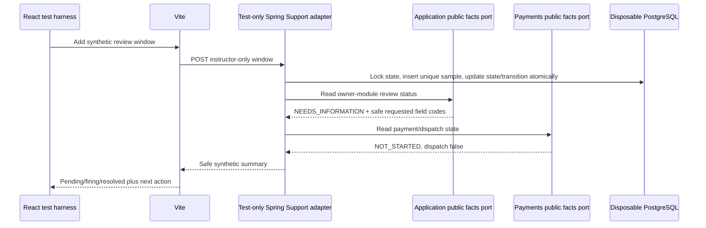
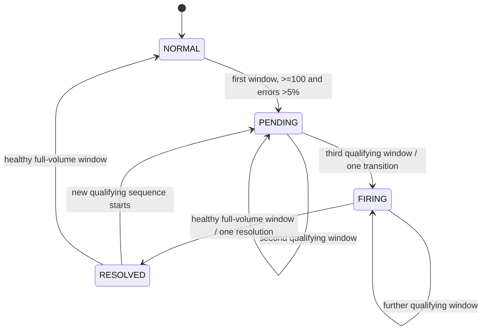

# CAP-114 review-alert window delta

## Instructor integration boundary

The test runs three 6/100 windows (NORMAL → PENDING → PENDING → FIRING), retries a repeated window ID without changing counts, resolves on a healthy 100-request window, and resets before the strict 5/100 and low-volume cases. PostgreSQL owns only instructor fixture rows and a single state/transition witness in `cap114_harness`; it is not a production Support store. The React view reads the test-only transport, not private customer data.

## State artifact

The fixed threshold is a learning rule, not a provider SLA. A `NEEDS_INFORMATION` review is shown with a bounded next-action code and requested synthetic field names; it is not transformed into a rejection, issuance, payment, dispatch or active-cover claim.

## Status and remaining product work

Instructor Chromium → Vite → test-profile Spring → disposable PostgreSQL is exercised. `Application` and `Payments` facts are read through their public ports. The only main-source rule, `ReviewAlertWindow.evaluate`, remains a visible learner TODO. The regular application has no alert controller, durable alert store, authenticated Support identity adapter, or production React placement. Those pieces remain blocked prerequisites; the instructor reference reducer does not satisfy the learner task.
