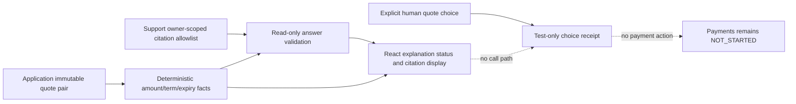

# CAP-115 revised-offer explanation delta

```mermaid
sequenceDiagram
  participant Browser as React test harness
  participant Support as Test-only Spring harness
  participant App as Application public offer facts
  participant Src as Support public citation allowlist
  participant Pay as Payments public facts
  participant PG as Disposable PostgreSQL
  Browser->>Support: Validate fixed model-shaped answer variant
  Support->>App: Load exact original/revised quote pair
  App->>PG: Read immutable quote snapshots
  Support->>Src: Read citations authorized for quote owner
  Src->>PG: Read source/version allowlist
  Support->>Support: Apply strict typed answer oracle
  Support-->>Browser: SUPPORTED / REJECTED / INSUFFICIENT_EVIDENCE
  Browser->>App: Keep deterministic amount/term/expiry facts visible
  Browser->>Support: Explicit user choice with current offer ID/revision/hash
  Support->>Pay: Read payment status only
  Pay-->>Support: NOT_STARTED; dispatch false
  Support->>PG: Record test-only human quote-choice receipt
  Note over Support,Pay: No model route to choice; no payment, dispatch, or active cover
```

## Deterministic offer facts

The synthetic pair is immutable `q1` at 100,000 INR paise and `o2` at 110,000 paise. The displayed delta is 10,000 paise (₹100.00), with exact revised terms, content hash, and expiry. The fixed test adapter accepts only the revised quote's exact id/hash, an exact claim delta, symmetric term-code changes, expiry, a supported status, and owner-scoped `offer-source-a@v2` citations. Missing/foreign/stale/unknown claims are rejected. No source permits a valid empty-citation `INSUFFICIENT_EVIDENCE` result.

## State and responsibility boundary



`ReviewedOfferAnswerValidator.validate` is the learner TODO. The Chromium/Vite/Spring/PostgreSQL path uses an independent test-only fixed-response validator and instructor principal. Its table records only a user choice tied to the authoritative revised offer id/revision/hash. The ordinary application has no answer route, offer-choice route, production AI/model integration, or persisted explanation service. No acceptance command, payment attempt, dispatch, issuance, active cover, model inference, or customer data is part of this harness.
