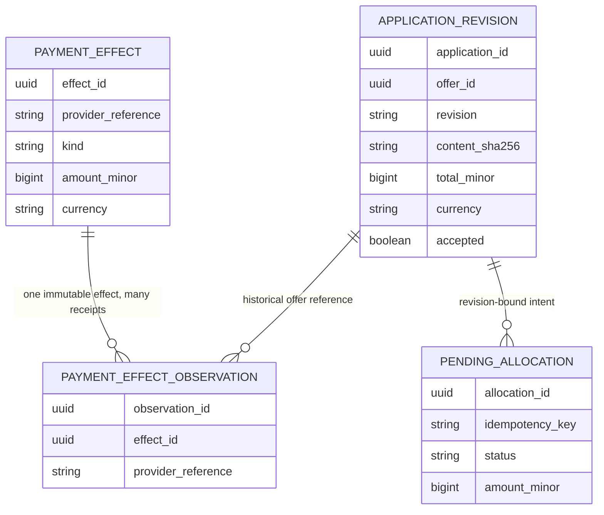

# CAP-116 accepted-revision reconciliation

Application owns the accepted revision. Payments owns confirmed effects and pending reservations. The report binds to the exact accepted offer ID/revision/content hash, computes `confirmed captures − confirmed refunds`, reports pending payment/refund reservations separately, and calculates the adjustment in integer paise. Duplicate observations do not multiply an immutable effect. Any pending reservation requires wait/reconcile; orphan or currency-mismatch evidence blocks a new allocation.

The test-only reference flow reads Application and Payments facts through public module ports and returns a report. It does not write payment, refund, dispatch, or allocation state. `AcceptedRevisionBalance.reconcile` remains the learner TODO. The 150-minute timebox has not been rehearsed.

Interview prompt: a 10,000 paise adjustment is in flight when the accepted offer changes from 110,000 to 90,000. Explain why the next step is to reconcile the existing intent instead of blindly creating a refund.
