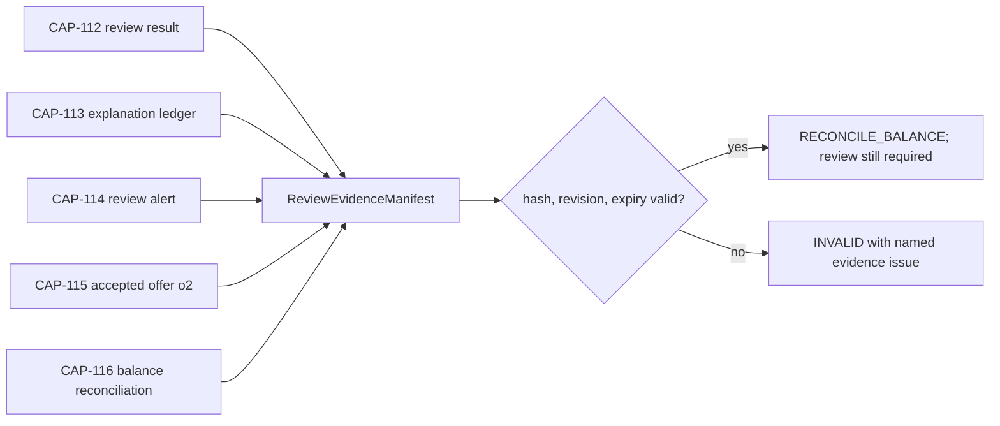

# CAP-117 evidence bundle delta — proposed

The Application manifest binds each artifact path to a SHA-256 and revision. It reuses CAP-115 `o2` owner/offer terms hash. Verification establishes synthetic fixture integrity and scoped facts only; it is not evidence of insurer approval, policy issuance, payment dispatch or active cover. The production `verify` method is an explicit learner TODO. Only the independent instructor oracle is runnable.
