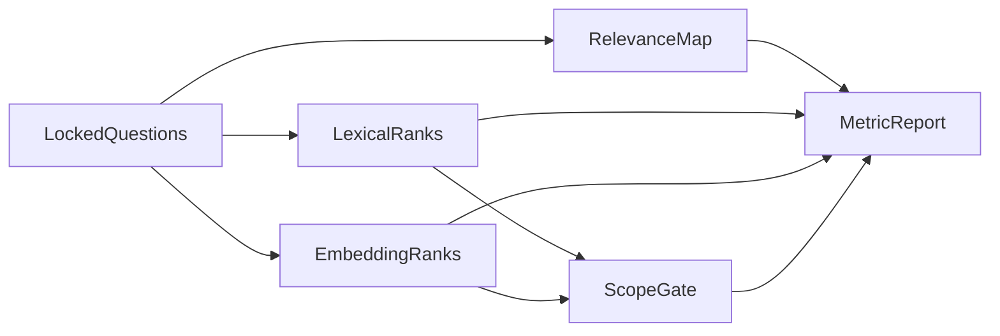

# CAP-118 retrieval experiment data flow

Status: instructor fixed-rank oracle verified; learner metric remains TODO; no model, vector index or live source query exercised.

Named nodes: LockedQuestions, RelevanceMap, LexicalRanks, EmbeddingRanks, ScopeGate, MetricReport.

Annotated facts:

1. Both candidate rank arrays use the same four query and relevance IDs.
2. An unauthorized source vetoes adoption separately from Recall@3/MRR.
3. Precomputed ranks do not require a runtime embedding index.

Alternative considered: install an embedding database before measuring against the lexical baseline. The fixed synthetic experiment needs no database and does not show the expected value of a live index.

Interview prompt: the embedding fixture improves recall but returns `br1` to owner A. Which metric may still be reported, and why can adoption not proceed? Answer: report the observed metric with its four-query denominator and rank list, but reject promotion because source authorization is an independent security gate.

Failure evidence: the unauthorized-source probe and the absent-rank q4 row. The actual learner observations remain NOT_RUN until the TODO implementation runs.
