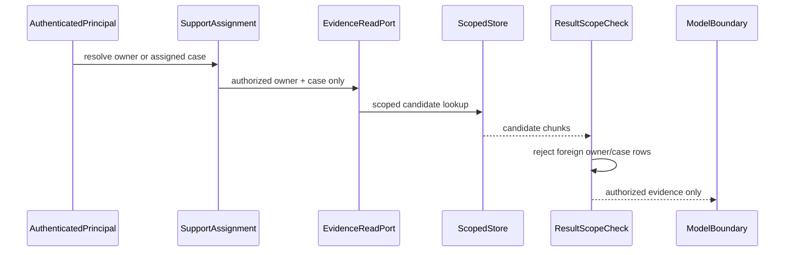

# CAP-119 policy/help evidence boundary

Status: proposed; instructor oracle authored, execution NOT_RUN; learner implementation remains TODO.

Facts:

1. Authenticated identity establishes owner scope; request scope is not authority.
2. Owner or assignment authorization precedes lookup.
3. Adapter rows are checked again before serialization or model access.

Alternative: filter foreign chunks after model invocation or rendering. Rejected because the text has already crossed the protected boundary.

Interview prompt: the store ignores its owner filter and returns BETA_CANARY. Which independent boundary prevents exposure? The result-scope check rejects the entire unsafe result before the response/model sink; tests assert the canary is absent from both.

The artifact explains the proposed sequence only. No public module API, database store, model client, or runtime product flow is claimed as implemented.
