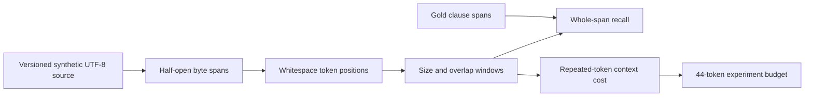

# CAP-120 — stable clause citations across chunk windows

**Status:** proposed instructor model; oracle and fixture authored, test execution status in the evidence record. Learner seam is TODO.

The reference tokenizer treats each Unicode whitespace-delimited sequence as one token. Windows expose original UTF-8 byte offsets, not reconstructed text offsets. Clause recall counts a clause only when one emitted window contains the entire saved span. Context cost adds every window token, including repeated overlap; it is deliberately not a model-token estimate.

The fixed pair makes the constraint visible: the compact configuration spends 54 tokens and recovers zero of two complete spans; the wider configuration spends 44 tokens and recovers one of two. The large heading-to-body policy clause is contained; the help-note clause is not. The saved evidence supports comparing one recall/cost point against another, not declaring a universal optimum.

Validation rejects malformed, overlapping, out-of-source, and UTF-8-splitting spans before chunk iteration; `overlap >= size` is invalid to prevent a non-advancing window. The instructor implementation is an independent test oracle and does not invoke the learner seam.

Interview prompt: why does the wider window recover the cross-heading clause while the compact setting consumes more total context, and why are byte offsets part of the citation contract? Explain the fixed whitespace tokenizer's limits before proposing a production tokenizer.
