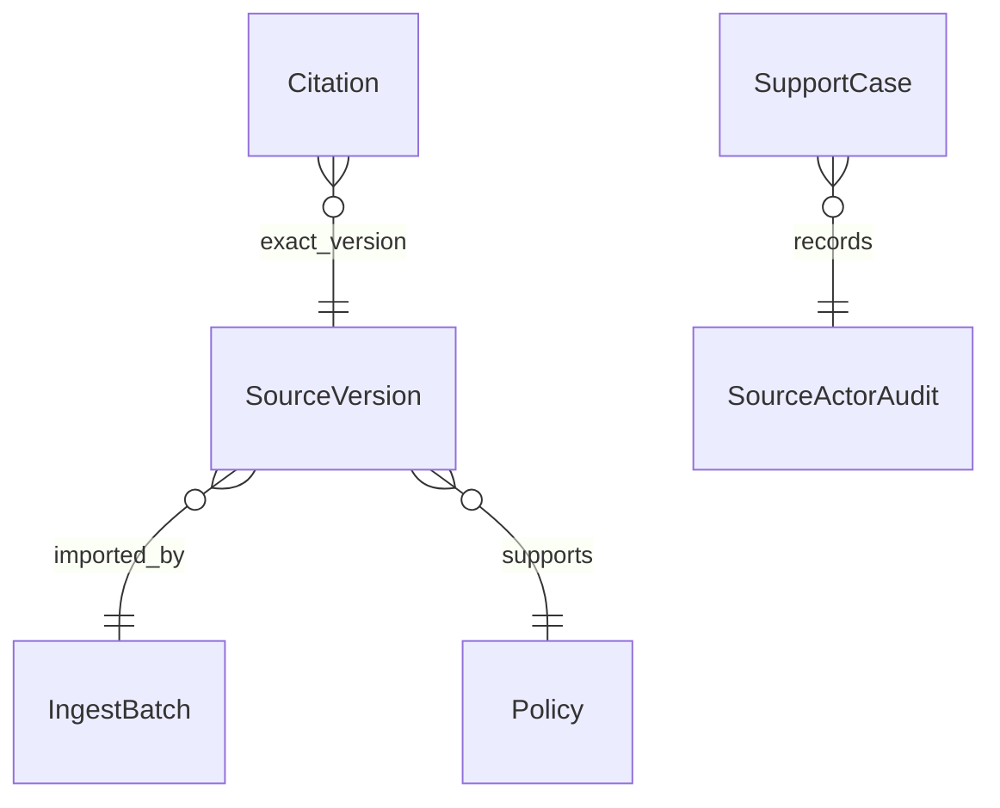

# CAP-121 citation lineage — proposed bounded artifact

Status: instructor fixture/oracle authored; execution NOT_RUN; learner logic TODO; public product integration BLOCKED.

Nodes (six maximum): Citation, SourceVersion, IngestBatch, Policy, SupportCase, SourceActorAudit.

Facts to annotate (three maximum):

1. `Citation.version_id` and its byte offsets point into one immutable source version.
2. Version, batch, and evidence ownership must agree; cross-module reads use owner interfaces, never repositories.
3. A Support case audit entry records bounded source and actor identifiers with its required domain event.

Alternative: resolve every historical citation against the latest version. Rejected because changed policy content would rewrite what the original explanation meant; missing v2 must remain broken rather than silently become v1.

Interview prompt: v2 is missing and v1 exists. The answer may report unavailable/broken lineage, but cannot quote v1 as if it were v2 or treat a source-dated limit as an accepted quote.

This is a proposed relationship sketch, not a migration, schema, runtime trace, or implemented Support case. The repository currently lacks the public SupportReadApi, owning Application/Policy/Payments adapters, transaction-backed case audit, and model boundary needed to execute this flow. The fixed instructor oracle asserts a read-only resolution with zero writes; it does not demonstrate those integrations.
