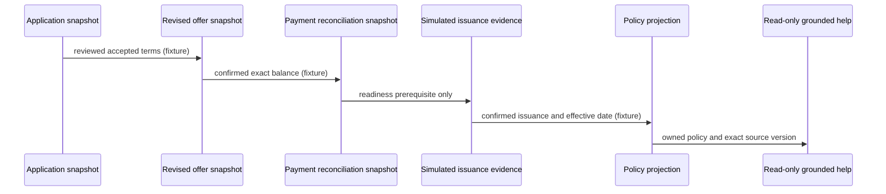

# CAP-123 bounded architecture delta

Status: instructor fixture model only; the integrated product lifecycle and learner gate are **not implemented**.

Facts changed: (1) accepted terms and confirmed reconciliation precede readiness; (2) only simulated issuance/effective-cover evidence enables a policy projection; (3) help has no command or write capability. Alternative considered: treat payment/offer acceptance as a policy. Rejected because payment, insurer dispatch, issuance, and effective cover are distinct facts.

Interview prompt: Which separate records prove payment, reviewed acceptance, insurer submission, and issuance? The fixture can illustrate the distinction but does not execute those transitions.

Missing prerequisites: no assembled Day 077–089 end-to-end transaction harness, no public `PolicyCommandApi`/support read API, no owning-module adapters for application, revised offer, reconciliation, issuance, policy persistence or authorization, and no deterministic transaction boundary. CAP-123 supplies only a DTO seam and independent oracle; it must not be represented as live readiness or a working product flow.
