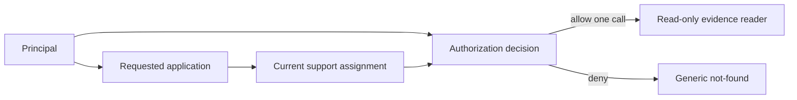

# CAP-125 · per-invocation read authorization

Status: PROPOSED / instructor scaffold; no learner implementation or production adapter verified.

The role, owner binding, and support assignment are resolved for each invocation. Conversation claims and earlier decisions are not inputs to authorization. Denial returns a generic response without foreign identifiers or source text. The tool wrapper exposes only a narrow facts reader, with no mutation command capability.

Alternative considered: trust the model's admin claim or reuse an earlier approval. This fails when support assignment changes between calls and makes a conversation transcript an authorization token. Interview prompt: an assigned support role loses assignment between calls; which check must run again and why?

Learner artifact task: annotate at most three facts and mark links that are absent from the real product APIs. This diagram is not evidence that the lifecycle transition or adapters exist.
