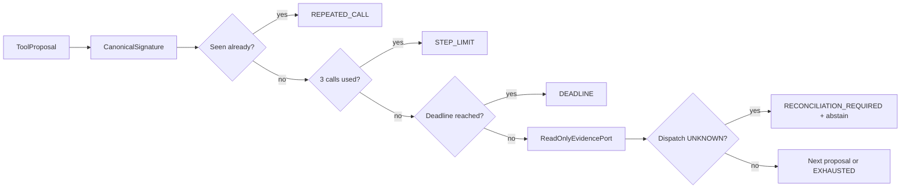

# CAP-126 bounded investigation loop

The instructor oracle uses a deterministic in-memory port and demonstrates the fixed boundaries without database, network, model, or product module access. Repeated signatures are normalized across case and surrounding whitespace and are rejected before the next read. A read that consumes the full deadline ends the loop; UNKNOWN dispatch terminates with an explicit insufficient-evidence result. The learner implementation remains `TODO(CAP-126)`.

Runtime integration remains blocked: no owning Application/Payments read adapters or public SupportReadApi were wired by this scaffold. The seam has no command/mutation capability, and the oracle's static fake adapter must not be represented as a production integration.

Interview prompt: if the initial read takes the full 2500ms and dispatch remains unknown, why can the assistant not infer that cancellation or refund is safe?
