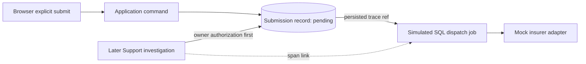

# CAP-175 bounded trace correlation

The later support query is a new trace and links to completed dispatch work. A missing reference stays unresolved. Span IDs, trace IDs and links are observability metadata; they do not authorize reading the Application or change submission status. The provided witness is a pure instructor oracle, not a production tracing or Support API.
