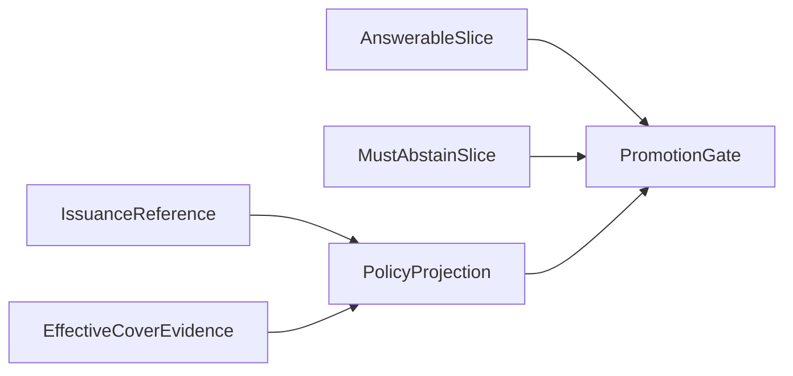

# CAP-176 issuance evidence and slice gate

Status: fixed synthetic instructor oracle prepared; learner predicate and evaluator remain TODO; integrated product flow is not demonstrated.

Named nodes: IssuanceReference, EffectiveCoverEvidence, PolicyProjection, AnswerableSlice, MustAbstainSlice, PromotionGate.

Changed facts:

1. Policy projection allows simulated active-cover wording only when issuance reference and effective-cover evidence both exist.
2. Per-slice denominators and failure IDs stay visible beside aggregate accuracy.
3. Must-abstain regression blocks promotion despite equal overall score.

Alternative considered: treat payment success and aggregate answer accuracy as the release signals. That would permit claims of active cover before confirmed simulated issuance and hide a concentrated abstention regression.

Interview prompt: both models score 18/20, but two pending-policy questions now claim active cover. Why hold the candidate? Answer: the aggregate obscures that must-abstain accuracy dropped from 10/10 to 8/10; pending submission/payment is not issuance evidence.

Failure cases: `CAP-176-CS-2` missing issuance facts and `CAP-176-CS-3` empty/mislabeled slices. The fixed expected values are fixture expectations; observed learner outputs remain NOT_RUN.
