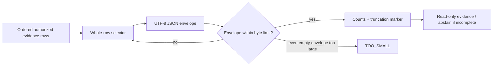

# CAP-177 bounded lifecycle evidence

The instructor oracle serializes a synthetic envelope and checks the total UTF-8 byte count, including punctuation and metadata. It removes complete rows only and preserves both included and available counts. If the dispatch acknowledgement falls outside the row bound, the result is explicitly incomplete; that absence cannot be used to claim no dispatch occurred. The learner seam remains `TODO(CAP-177)` and has no cancellation/refund capability.

Interview prompt: if the only acknowledgement is row three and the result is capped at two rows, why must the answer avoid an “unsubmitted” or “refundable” conclusion?
