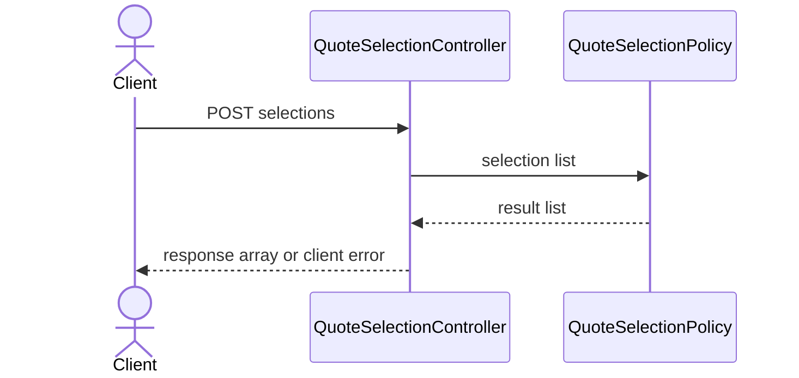

# Day 1 — Synthetic quote selection invariant

## Work budget

Total scheduled learning is 180 minutes: 60 minutes of Java DSA separately,
plus 120 engineering minutes. Engineering is 85 minutes implementation and
testing, 25 minutes concept/course, and 10 minutes evidence. Instructor-owned
scaffolding and setup are outside this budget. There is no extra mandatory
setup work. Record actual time; do not claim this allocation is validated until
a learner attempt has been measured.

## Separate Java DSA block — LeetCode 121 (60 minutes)

This is Advait's first independent LeetCode 121 attempt; independent-solve
credit remains zero until an unaided attempt is recorded. Preserve the
historical reports of three screenshots and seven assisted practice sessions
as assisted practice. Advait reports that today's DSA course/learning portion
is complete; this does not mark the independent solve or reviews complete.
The planned first-attempt date is 20 October 2026; actual attempt and review
completion remain unrecorded. Use the remaining planned 20 minutes to solve
independently and 15 minutes for active retrieval/error log, within the same
60-minute DSA block (no extra time). The D+3,
D+7, and D+21 reviews are due from the actual first-attempt date. If the first
attempt occurs on 20 October, planned review dates are 23 October, 27 October,
and 10 November; recalculate if the actual date differs. These reviews remain
inside the same 60-minute DSA block and are not complete automatically. Use the
[error-log template](reboot/dsa-error-log-template.md) to record independent
or assisted status, mistakes, next action, and due/completed review dates.
The learner method is `src/main/java/assignments/dsa/BestTimeToBuySellStock.java`
and its fixed acceptance tests are
`src/test/java/assignments/dsa/BestTimeToBuySellStockAcceptanceTest.java`.
Implement the maximum profit from one buy followed by one later sell. Return
zero for null, empty, one-day, or non-profitable input; do not mutate
the array. Prices follow LeetCode 121's inclusive range `0..10_000`. Expected
target: O(n) time and O(1) auxiliary space. Explain descending-price, repeated-
price, and minimum/maximum boundary cases. The current main revision contains
a learner-authored implementation. This documentation update did not run the
DSA acceptance selector; independent-solve credit remains unrecorded until the
learner confirms an unaided attempt.

Run the acceptance check separately and record its actual result; it is no
longer an expected TODO failure:

```sh
./mvnw -Plearner-tests -Dtest=BestTimeToBuySellStockAcceptanceTest test
```

## Feature and learning goal

## First API lesson — follow along before adapting

**Owned Udemy course:** [*Master Spring Boot 3 & Spring Framework 6 with Java*](https://www.udemy.com/course/spring-boot-and-spring-framework-tutorial-for-beginners/), by in28Minutes Official. In **“Creating a Java REST API with Spring Boot, Spring Framework and Hibernate,”** study these verified lesson titles in order: **“Step 00 - Creating a REST API with Spring Boot - An Overview” (4:04), “Step 01 - Initializing a REST API Project with Spring Boot” (7:26), “Step 02 - Creating a Hello World REST API with Spring Boot” (6:21),** and **“Step 03 - Enhancing the Hello World REST API to return a Bean” (4:30).** Total viewing time is 22:21 at 1×. Stop at 25 minutes, allowing a small pause/retrieval margin. Match by title rather than number. Carry the next lesson, **“Step 04 - What's happening in the background? Spring Boot Starters & Autoconfig” (9:06),** forward if the cap is reached.

Pass the instructor readiness gate (`./mvnw -Dtest=QuoteSelectionInfrastructureTest test`). If it fails, record the blocker and use the instructor-provided runnable app; do not spend learner time on setup. First reproduce the demonstrated endpoint with the course. Then make a tiny adaptation: send one request to `POST /api/quote-selections` and observe its documented response/error behavior. This orientation does not complete the full quote-selection assignment. Its acceptance contract remains authoritative; composite identity/order behavior and full learner acceptance remain deferred until the API prerequisite is understood.

Keep course study within the existing 25-minute course allocation inside 120 engineering minutes; unfinished lessons carry forward and implementation scope shrinks. No extra hours or design case study are required. Explain: **How does a request reach a Java method, and how does its result become JSON?**

```text
HTTP request (path + JSON) → Spring maps it to a controller Java method
→ method returns a Java value → Spring serializes it as JSON
→ HTTP response (status + JSON)
```

The full Days 1–30 lesson map is [here](reboot/course-learning-map.md). Do not overwrite the learner TODO or claim assignment completion from the follow-along.

**AWS certification:** No AWS certification course or lecture is assigned on Day 1. The confirmed AWS courses are CLF-C02 Cloud Practitioner and Solutions Architect Associate; neither is Developer Associate. This day’s concept is local backend API learning, not AWS exam study.


CoverStory starts as an enterprise insurance lifecycle simulation. Day 1 uses
the single synthetic product fixture at `fixtures/day-1/home-secure.json` for
product context; fixed acceptance inputs are inline and do not load that
fixture.
The small slice establishes that a quote selection is identified
by both journey and quote version, duplicates are removed in first-seen order,
and invalid input is rejected before a result is returned. No catalog database,
authentication, payment, policy activation, Kafka, or frontend is needed for
this exercise.

The learner implementation belongs only in
`src/main/java/assignments/insurance/QuoteSelectionPolicy.java`. For the 25-minute
concept block, pair the API objective with the short request-flow view below;
write a brief reason for composite identity and encounter order without writing
the implementation. This is the day's design practice, not extra work.



Keep the design note inside the existing 10-minute evidence allocation. The
[system design practice guide](reboot/system-design-practice.md) provides a
blank prompt and templates; there is no required infrastructure setup.

## Behavioral cases

The fixed acceptance suite is
`src/test/java/assignments/insurance/QuoteSelectionAcceptanceTest.java`.

| Input | Expected result |
| --- | --- |
| `[(journey-B, home-secure-v1), (journey-A, home-secure-v1), (journey-B, home-secure-v1)]` | First two exact pairs, same order; input unchanged |
| `[]` | `[]` |
| Same quote version under two journey IDs | Two distinct keys |
| Null list, null entry, or null/empty/blank `journeyId` or `quoteVersionId` | `IllegalArgumentException`; no partial result |
| `home-secure-v1` and ` home-secure-v1` | Distinct exact values; no trimming |
| `("journey-A|journey-B", "home-secure-v1")` and `("journey-A", "journey-B|home-secure-v1")` | Distinct composite pairs even when values contain delimiters |

The runnable Spring Boot app starts with `./mvnw spring-boot:run`. The supplied
API is `POST /api/quote-selections`, with JSON
`{"selections":[{"journeyId":"journey-B","quoteVersionId":"home-secure-v1"}]}`.
After the learner TODO is implemented, valid input returns HTTP 200 and a JSON
array of exact composite keys. Missing request body, malformed JSON, or invalid
selections return HTTP 400. Before implementation, valid selection requests
reach the explicit `UnsupportedOperationException` TODO and return HTTP 500;
that is the expected red learner state. The API adapter is instructor-owned;
the domain invariant is learner-owned.

## Run commands

From the repository root, instructor infrastructure is separate and should
pass before touching the learner TODO:

```sh
./mvnw -Dtest=QuoteSelectionInfrastructureTest test
```

The learner acceptance suite is intentionally excluded by default. Before the
TODO is implemented, this should fail with the explicit
`Day 1 learner TODO: implement uniqueSelections` exception:

```sh
./mvnw -Plearner-tests -Dtest=QuoteSelectionAcceptanceTest,QuoteSelectionApiAcceptanceTest test
```

The regular documented project command remains:

```sh
./mvnw test
```

## Concept prompt — local API and request contract (inside the existing 25 minutes)

Use the course lessons above to see how an HTTP request reaches a Spring controller, how the controller calls Java code, and how a returned Java value becomes JSON. For the tiny adaptation, identify the request body, Java method, response JSON, and status code. Do not implement the quote-selection policy during the concept block. Explain why exact composite identity and encounter order are part of this API’s response contract; the full acceptance assignment stays deferred until the API prerequisite is understood. No AWS account, infrastructure, or cloud deployment is part of Day 1.

## Evidence

Use the 10-minute evidence allocation to record exact commands, exit codes,
test counts, and any first TODO stack trace in the learner's own notes. Do not
mark the learner task complete from infrastructure checks alone.
