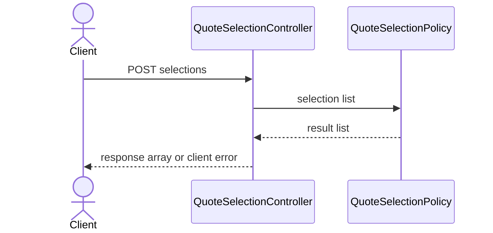

# Day 1 — Synthetic quote selection invariant

## Work budget

Total scheduled learning is 180 minutes: 60 minutes of Java DSA separately,
plus 120 engineering minutes. Engineering is 85 minutes implementation and
testing, 25 minutes concept/course, and 10 minutes evidence. Instructor-owned
scaffolding and setup are outside this budget. There is no extra mandatory
setup work. Record actual time; do not claim this allocation is validated until
a learner attempt has been measured.

## Separate Java DSA block — LeetCode 121 (60 minutes)

This is Advait's first independent LeetCode 121 attempt; independent-solve
credit for this problem is currently zero. This is a DSA-credit status only:
it preserves the historical reports of three screenshots and seven assisted
practice sessions, which remain recorded as assisted practice rather than
independent solves. The
planned first-attempt date is 20 October 2026; the actual attempt date and
review completion remain unrecorded until Advait records them. Use 25 minutes
to learn the running-state array pattern, 20 minutes to solve independently, and
15 minutes for active retrieval and the error log (60 minutes total). The D+3,
D+7, and D+21 reviews are due from the actual first-attempt date. If the first
attempt occurs on 20 October, planned review dates are 23 October, 27 October,
and 10 November; recalculate if the actual date differs. These reviews remain
inside the same 60-minute DSA block and are not complete automatically. Use the
[error-log template](reboot/dsa-error-log-template.md) to record independent
or assisted status, mistakes, next action, and due/completed review dates.
The learner method is `src/main/java/assignments/dsa/BestTimeToBuySellStock.java`
and its fixed acceptance tests are
`src/test/java/assignments/dsa/BestTimeToBuySellStockAcceptanceTest.java`.
Implement the maximum profit from one buy followed by one later sell. Return
zero for empty, one-day, or non-profitable input; reject `null`; do not mutate
the array. Prices follow LeetCode 121's inclusive range `0..10_000`. Expected
target: O(n) time and O(1) auxiliary space. Explain descending-price, repeated-
price, and minimum/maximum boundary cases. The solution is intentionally left
as a TODO.

Run the acceptance check separately; it is expected to fail at the explicit
TODO until implemented:

```sh
./mvnw -Plearner-tests -Dtest=BestTimeToBuySellStockAcceptanceTest test
```

## Feature and learning goal

## First API lesson — follow along before adapting

**Owned Udemy course:** *Master Spring Boot 3 and Spring Framework 6 with
Java*, by in28Minutes Official. In the course section **“Creating a Java REST
API with Spring Boot, Spring Framework and Hibernate,”** study these lessons
in order, for up to 25 minutes total: **“Creating a REST API with Spring Boot overview,” “Initializing a REST API with Spring Boot,” “Creating a Hello World REST API with Spring Boot,”** and **“Enhancing the Hello World REST API to return a bean.”** Lesson titles are used instead of section or lecture numbers because numbering can change. Stop at 25 minutes and carry unfinished lessons forward inside the next engineering block; do not add study time.

The prerequisite gate is a working Java 21/Maven starter and the
`QuoteSelectionInfrastructureTest` passing. If it does not pass, record the
blocker and use the instructor-provided runnable app; do not spend learner
time on setup. First follow the course to understand and reproduce one
demonstrated endpoint. Then make only a tiny adaptation in the starter: send
one request to `POST /api/quote-selections` and observe the documented
response/error behavior. This is an orientation exercise, not completion of
the full quote-selection assignment. The fixed acceptance tests remain the
definition of that assignment; their composite-identity/order and validation
cases are deferred until the course/API prerequisite is understood. Do not
claim they pass because a Hello World endpoint runs.

Keep this within the existing 120 engineering minutes: up to 25 minutes for
course learning, with unfinished lessons carried forward and implementation
scope reduced that day. No additional daily hours or design case study are
required. Reflection: **How does a request reach a Java method, and how does
that method's result become JSON?** A simple model is:

```text
HTTP request (path + JSON) → Spring maps it to a controller Java method
→ method returns a Java value → Spring serializes that value as JSON
→ HTTP response (status + JSON)
```

The runnable starter is the instructor's guided example. Do not overwrite the
learner TODO or mark the quote-selection implementation complete from this
follow-along.

CoverStory starts as an enterprise insurance lifecycle simulation. Day 1 uses
the single synthetic product fixture at `fixtures/day-1/home-secure.json` for
product context; fixed acceptance inputs are inline and do not load that
fixture.
The small slice establishes that a quote selection is identified
by both journey and quote version, duplicates are removed in first-seen order,
and invalid input is rejected before a result is returned. No catalog database,
authentication, payment, policy activation, Kafka, or frontend is needed for
this exercise.

The learner implementation belongs only in
`src/main/java/assignments/insurance/QuoteSelectionPolicy.java`. For the 25-minute
concept block, pair the API objective with the short request-flow view below;
write a brief reason for composite identity and encounter order without writing
the implementation. This is the day's design practice, not extra work.



Keep the design note inside the existing 10-minute evidence allocation. The
[system design practice guide](reboot/system-design-practice.md) provides a
blank prompt and templates; there is no required infrastructure setup.

## Behavioral cases

The fixed acceptance suite is
`src/test/java/assignments/insurance/QuoteSelectionAcceptanceTest.java`.

| Input | Expected result |
| --- | --- |
| `[(journey-B, home-secure-v1), (journey-A, home-secure-v1), (journey-B, home-secure-v1)]` | First two exact pairs, same order; input unchanged |
| `[]` | `[]` |
| Same quote version under two journey IDs | Two distinct keys |
| Null list, null entry, or null/empty/blank `journeyId` or `quoteVersionId` | `IllegalArgumentException`; no partial result |
| `home-secure-v1` and ` home-secure-v1` | Distinct exact values; no trimming |
| `("journey-A|journey-B", "home-secure-v1")` and `("journey-A", "journey-B|home-secure-v1")` | Distinct composite pairs even when values contain delimiters |

The runnable Spring Boot app starts with `./mvnw spring-boot:run`. The supplied
API is `POST /api/quote-selections`, with JSON
`{"selections":[{"journeyId":"journey-B","quoteVersionId":"home-secure-v1"}]}`.
After the learner TODO is implemented, valid input returns HTTP 200 and a JSON
array of exact composite keys. Missing request body, malformed JSON, or invalid
selections return HTTP 400. Before implementation, valid selection requests
reach the explicit `UnsupportedOperationException` TODO and return HTTP 500;
that is the expected red learner state. The API adapter is instructor-owned;
the domain invariant is learner-owned.

## Run commands

From the repository root, instructor infrastructure is separate and should
pass before touching the learner TODO:

```sh
./mvnw -Dtest=QuoteSelectionInfrastructureTest test
```

The learner acceptance suite is intentionally excluded by default. Before the
TODO is implemented, this should fail with the explicit
`Day 1 learner TODO: implement uniqueSelections` exception:

```sh
./mvnw -Plearner-tests -Dtest=QuoteSelectionAcceptanceTest,QuoteSelectionApiAcceptanceTest test
```

The regular documented project command remains:

```sh
./mvnw test
```

## Concept prompt — AWS DVA-C02 Domain 1, Task 1, Skill 1.1.6

Read the [official Developer Associate Domain 1 objective](https://docs.aws.amazon.com/aws-certification/latest/developer-associate-02/developer-associate-02-domain1.html),
Task 1, Skill 1.1.6, “Create, extend, and maintain APIs.” The 25 minutes is our
planner allocation, not an AWS-published lesson duration. Use this local Spring
endpoint to define request validation, response shape, and HTTP success/error
codes; no AWS account, infrastructure, or cloud deployment is part of Day 1.
In the same concept block, explain why exact composite identity matters, how
encounter order is part of the response contract, and why an in-memory selection
is neither durable state nor authorization. Distinguish this in-memory rule from
later database uniqueness, transaction atomicity, and concurrent retry safety. Distinguish this in-memory rule from
later database uniqueness, transaction atomicity, and concurrent retry safety. Do not implement the policy during
the concept block.

Sketch the request → controller → policy → response path and mark the
validation boundary. State the composite-identity and encounter-order
invariants in your own words. Choose a sequence or module view; do not add a
database, cache, service, or infrastructure for this in-memory slice. Use the
blank [design note](reboot/templates/design-note.md), [diagram prompt](reboot/templates/diagram-prompt.md),
and, only if a material choice merits it, [ADR template](reboot/templates/adr.md).
This fits inside the existing 85/25/10 engineering allocations; it is not extra
setup or a separate task.

## Evidence

Use the 10-minute evidence allocation to record exact commands, exit codes,
test counts, and any first TODO stack trace in the learner's own notes. Do not
mark the learner task complete from infrastructure checks alone.
